# RLMS — Review giao diện 02/10/2026

Đã sửa các lỗi bên dưới; xem [kết quả kiểm chứng ngày 03/10/2026](#kết-quả-sửa-và-kiểm-chứng--03102026).

## Phạm vi và phương pháp

- Mã được kiểm tra: `ffb0064`, nhánh `module/be-essay-validation`.
- Đối chiếu `AGENTS.md`, `UX_STRUCTURE.md`, quy tắc thiết kế và source local `nlt-smart-gas`.
- Đăng nhập tài khoản mẫu giảng viên và sinh viên trong tổ chức `RLMS-DEMO` trên hai hostname local riêng.
- Kiểm tra bằng trình duyệt: tổng quan, bài tập/bài thi, ngân hàng câu hỏi, sổ điểm, chọn lớp chấm bài, tiểu luận, báo cáo, điểm danh, quan sát bài làm, tab nội dung lớp và không gian chương trình/bài học.
- Kiểm tra desktop 1440×900, màn hình sinh viên 1280×720 và breakpoint mobile 375×812.
- Bố cục live được kiểm tra bằng fixture `/tests/live-layout.html`: 100 người, phân trang, bật trình bày và 1 người trình bày. Đây là mô phỏng layout, không phải kiểm thử truyền WebRTC giữa hai tài khoản.
- Không sửa mã ứng dụng, phát hành hoạt động, nộp bài, chấm điểm hay kết thúc phiên live trong lượt review này.

**Kết quả: 10 vấn đề — 7 xác nhận trên trình duyệt, 3 xác định từ source/contract.** P1 cần ưu tiên vì cản trở sử dụng hoặc làm bài; P2 cần sửa để giao diện và thông tin hoạt động đúng.

## Các vấn đề

### UI-01 · P1 · Sidebar làm giao diện mobile không sử dụng được

**Bằng chứng:** trình duyệt 375×812, trang `/activities`, sidebar mở rộng.

Sidebar vẫn rộng 268px, phần nội dung chỉ còn 107px. Chiều rộng tài liệu thành 629px; các thẻ và nút tràn khỏi màn hình, tiêu đề bị bẻ thành nhiều dòng.

**Tái hiện:** mở phiên có sidebar đang mở → thu viewport về 375px → vào Bài tập & Bài thi.

**Source:** `frontend/src/assets/styles.css:647` giữ chiều rộng/sidebar margin ở breakpoint mobile; `frontend/src/shared/stores/navigation.ts:97` mặc định sidebar mở rộng.

**Hướng sửa:** dùng điều hướng mobile phù hợp, không dành cố định 268px trong vùng nội dung. Source tham chiếu đã bỏ padding trái khi mobile tại `src/pages/admin/index.vue:53`.

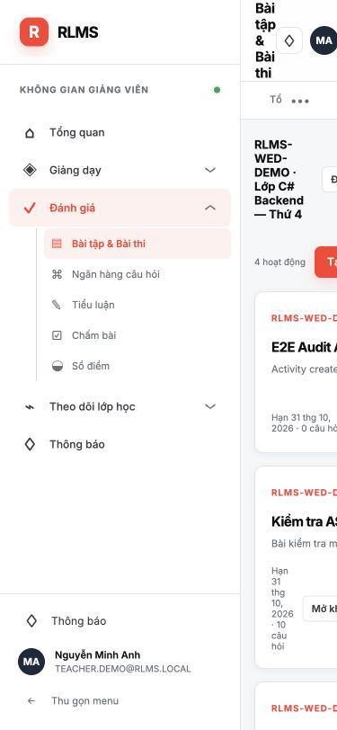

### UI-02 · P1 · Câu hỏi nhiều đáp án chỉ chọn được một đáp án

**Bằng chứng:** source và contract chấm điểm; chưa tạo bài nhiều đáp án để thử trên dữ liệu demo.

`StudentAttemptWorkspace` render tất cả câu có options bằng radio, lưu một `option.key`. Câu `MultipleChoice` có đáp án `A,C` không thể chọn cả hai. Chế độ observer cũng so sánh cả chuỗi với một key nên không thể đánh dấu đầy đủ các lựa chọn.

**Source:** `frontend/src/features/assignments/components/StudentAttemptWorkspace.vue:43`–57. Backend tại `backend/src/Modules/Assessment/Domain/GradingRules.cs:95`–101 yêu cầu toàn bộ tập đáp án phân tách dấu phẩy.

**Hướng sửa:** phân nhánh theo loại câu hỏi trong component dùng chung; checkbox cho nhiều đáp án, giữ radio cho một đáp án. Cần kiểm thử chọn/bỏ chọn, tải lại đáp án, observer và chấm điểm.

### UI-03 · P2 · Trạng thái còn hiển thị số và nhãn tiếng Anh

**Bằng chứng:** trình duyệt.

- Bài tập/bài thi và tiểu luận hiện badge `0/1`.
- Khóa học hiện `0/1`.
- Sổ điểm hiện `0/1` dưới điểm số.
- Báo cáo hiện `Absent` cạnh nhãn “Vắng”.
- Ngân hàng câu hỏi có hàng “Phiên bản 2 · Medium”, trong khi các hàng demo khác dùng “Trung bình”.

**Source:** `frontend/src/shared/ui/StatusPill.vue:8` trả số nguyên khi caller không truyền labels; `frontend/src/features/gradebook/pages/GradebookPage.vue:7` trả status trực tiếp. `frontend/src/shared/types/index.ts:549` thiếu mapping `Absent`; `frontend/src/features/assignments/pages/QuestionBankPage.vue:2` render difficulty trực tiếp.

**Hướng sửa:** mapping enum theo đúng domain cho cả dữ liệu số và chuỗi; không dùng một mapping số chung vì mỗi enum có ý nghĩa riêng. Chỉ dịch nhãn UI, không tự đổi tên khóa học hay nội dung do người dùng nhập.

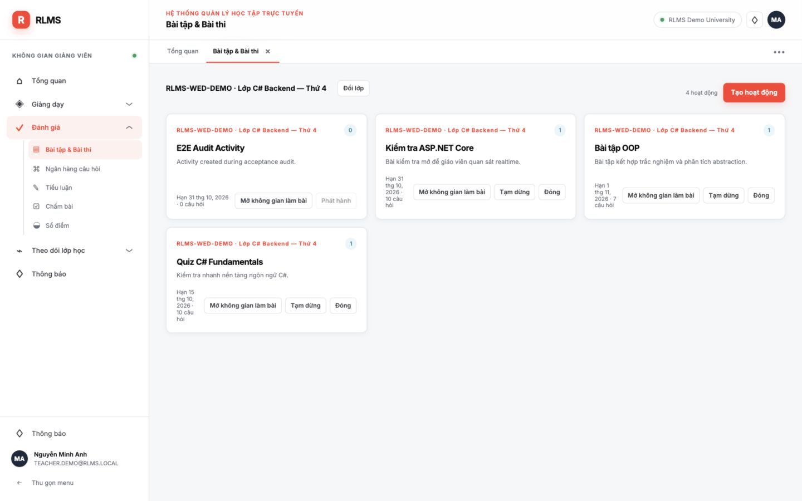

### UI-04 · P2 · Giảng viên không nhận diện được sinh viên bằng tên

**Bằng chứng:** trình duyệt sổ điểm, tổng quan hoạt động, observer và điểm danh.

Các màn hình chỉ hiện GUID rút gọn như `7ecbf458` hoặc “Sinh viên 7ecbf458”. Với lớp 25 người, giảng viên phải đối chiếu mã ở nơi khác để biết ai đang làm bài hoặc có điểm nào.

**Source:** `frontend/src/features/gradebook/pages/GradebookPage.vue:2`; `frontend/src/features/assignments/pages/ActivityWorkspacePage.vue:13`; `frontend/src/features/assignments/components/StudentAttemptWorkspace.vue:121`; `frontend/src/features/reports/pages/AttendancePage.vue:80`.

**Hướng sửa:** hiển thị tên và mã sinh viên nghiệp vụ trong read model nhẹ; giữ GUID làm khóa nội bộ. Không tải answer detail để bổ sung danh tính.

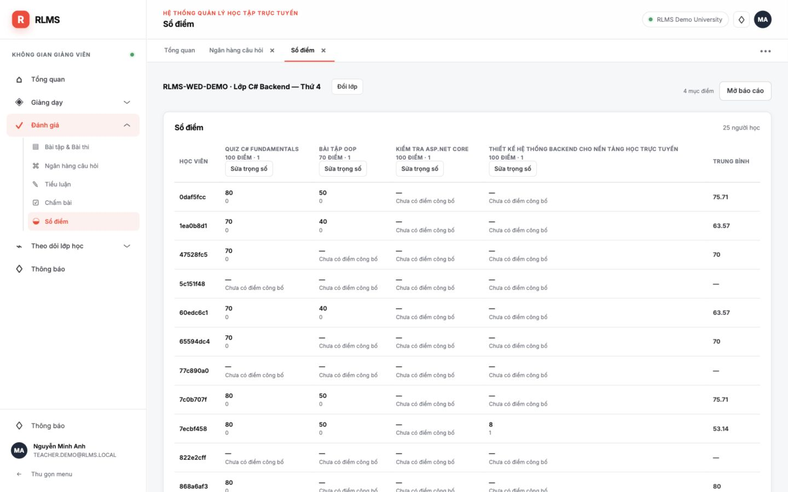

### UI-05 · P2 · Menu tài khoản bị cắt khi sidebar thu gọn

**Bằng chứng:** trình duyệt desktop.

Thu gọn sidebar → bấm avatar. Popup rộng 195px nhưng nằm trong sidebar 78px có `overflow:hidden`; vị trí đo được là `left=-130px`, `right=65px`. Tên tài khoản và chữ “Đăng xuất” bị cắt khỏi màn hình.

**Source:** `frontend/src/assets/styles.css:42` và `:98`; popup được render bên trong sidebar tại `frontend/src/app/layouts/AppShell.vue:46`.

**Hướng sửa:** đặt popup ngoài vùng clip hoặc mở về phía nội dung. Kiểm tra sidebar mở/thu gọn và viewport nhỏ.

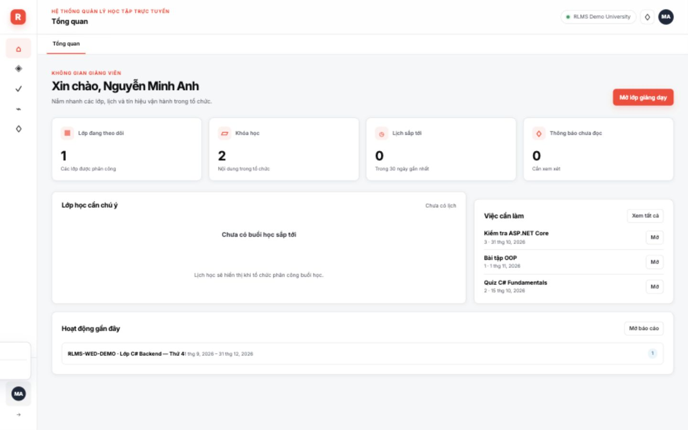

### UI-06 · P2 · Tab active bị khuất khi mở nhiều trang

**Bằng chứng:** trình duyệt desktop 1440×900.

Mở lần lượt ngân hàng câu hỏi, sổ điểm, hoạt động, một bài kiểm tra, tiểu luận, chấm bài, báo cáo, điểm danh rồi khóa học. Trang Khóa học đã mở nhưng tab active nằm hoàn toàn ngoài vùng nhìn thấy: tab bắt đầu ở x=1628 trong khi strip kết thúc ở x=1378; `scrollLeft=0`.

**Source:** `frontend/src/shared/ui/OpenedTabs.vue:4`; `frontend/src/assets/styles.css:123`. Không có xử lý cuộn tab active vào view, scrollbar còn bị ẩn.

**Hướng sửa:** cuộn active tab vào vùng nhìn thấy sau thay đổi route/title. Reference `src/components/Layout/WorkingBar/index.vue:150` đã dùng watcher và `scrollIntoView`.

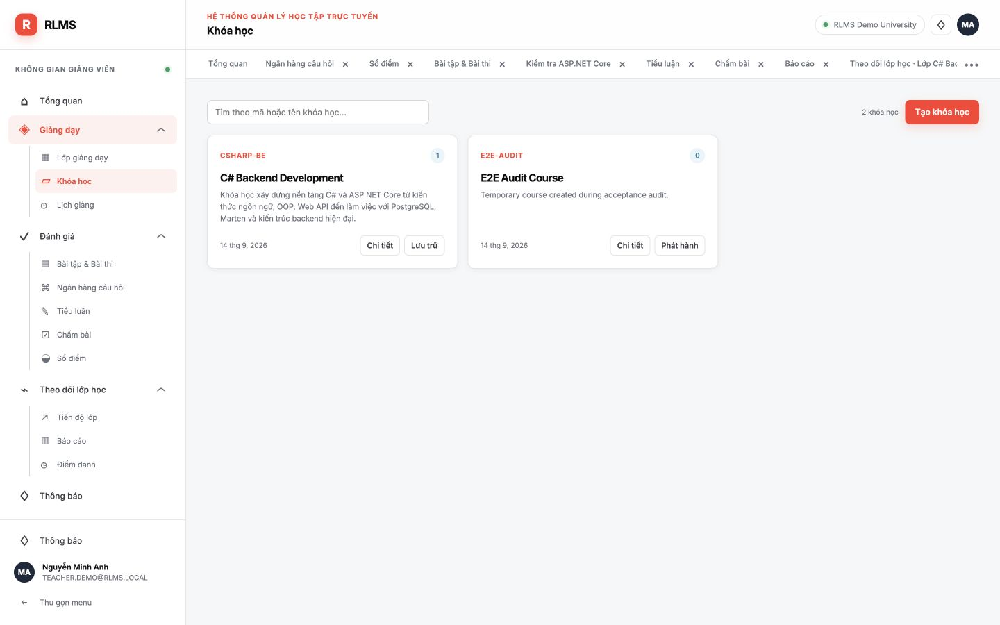

### UI-07 · P2 · Thanh lọc điểm danh ép tên lớp thành nhiều dòng

**Bằng chứng:** trình duyệt desktop 1440×900.

Tên lớp, Đổi lớp, ngày, buổi, search, số học viên và Xuất Excel nằm chung một hàng không đủ chỗ. Tên “RLMS-WED-DEMO · Lớp C# Backend — Thứ 4” bị ép còn khoảng 55px và bẻ thành nhiều dòng; vùng context cao 93px. Lỗi có ngay trên desktop, không chỉ mobile.

**Source:** `frontend/src/features/reports/pages/AttendancePage.vue:10`–32; `frontend/src/assets/styles.css:185`. Filters dùng flex không wrap và chưa cấp kích thước tối thiểu cho class context.

**Hướng sửa:** phân bố context và các bộ lọc bằng hàng/grid có wrap và breakpoint phù hợp; không thêm hero hoặc PageHeader lớn.

### UI-08 · P2 · Một hàng điểm danh vừa “Đi trễ” vừa “Đúng giờ”

**Bằng chứng:** trình duyệt `/attendance`, ngày 09/09/2026, buổi sáng đã kết thúc, dữ liệu demo hiện có.

Ví dụ hàng `0daf5fcc-bc8` hiển thị trạng thái “Đi trễ”, nhưng cột Đi trễ lại ghi “Đúng giờ”. Đây là thông tin mâu thuẫn, ảnh hưởng việc đối chiếu và xuất báo cáo.

**Source:** `frontend/src/features/reports/pages/AttendancePage.vue:276` lấy status từ record nhưng `:305`–326 tính lại độ trễ từ thời gian/session hiện tại. `Math.floor` cũng khiến trễ dưới một phút bị biến thành “Đúng giờ”. Backend có rule lateness tại `backend/src/Modules/Classroom/Attendance/AttendanceMessages.cs:441`.

**Hướng sửa:** thống nhất trạng thái và độ trễ theo nguồn dữ liệu nghiệp vụ; hiển thị “Dưới 1 phút” khi thực sự trễ. Đối chiếu dữ liệu lịch sử nếu đã được ghi theo rule cũ; không chỉ đổi badge để che mâu thuẫn.

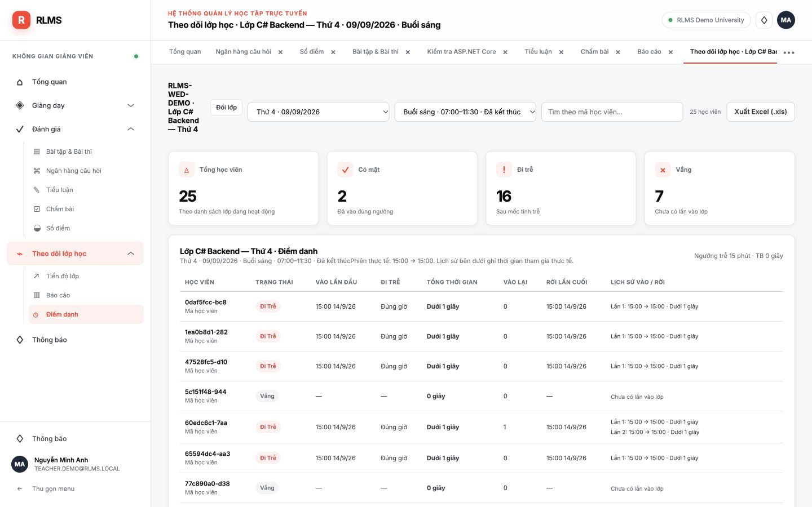

### UI-09 · P2 · Form vẫn bỏ mất lý do lỗi và hiện lỗi Axios tiếng Anh

**Bằng chứng:** source; chưa gửi form không hợp lệ trong lượt review này.

Form tạo lịch học, câu hỏi và cập nhật trọng số lấy `Error.message` trực tiếp. Với HTTP 400/409, người dùng nhận chuỗi như `Request failed with status code 400` thay vì lý do có thể sửa. Điều này còn phá yêu cầu đồng bộ tiếng Việt.

**Source:** `frontend/src/features/classrooms/pages/ClassDetailPage.vue:60`; `frontend/src/features/assignments/pages/QuestionBankPage.vue:11`; `frontend/src/features/gradebook/pages/GradebookPage.vue:10`.

**Hướng sửa:** dùng xử lý lỗi chung hiện có, lấy validation/business reason và mapping tiếng Việt. Kiểm thử end <= start và lỗi phát hành/conflict thật.

### UI-10 · P2 · Không đóng riêng application tab bằng bàn phím được

**Bằng chứng:** source/DOM accessibility.

Dấu × là `span` chỉ có click bên trong button tab. Không có focus hay keyboard action riêng; người dùng bàn phím chỉ kích hoạt tab, không thể đóng riêng tab đó. Tab cũng thiếu `aria-selected` thể hiện trạng thái hiện tại.

**Source:** `frontend/src/shared/ui/OpenedTabs.vue:4`–6.

**Hướng sửa:** control đóng độc lập, có accessible name và thao tác bàn phím, tránh button lồng button. Xác nhận focus sau khi đóng tab active và tab không active.

## Những điểm đã kiểm chứng hoạt động đúng trong phạm vi review

- `PageHeader` chỉ còn được dùng ở `DashboardPage`; trang chọn lớp bài tập/tiểu luận/chấm bài/sổ điểm/báo cáo không còn hero lớn.
- Teacher class selector có search + thẻ lớp; chỉ hiện hành động tạo tiểu luận sau khi vào lớp.
- Sinh viên mở Nội dung khóa học vẫn ở layout/tab lớp, thấy curriculum card; chọn curriculum mới mở workspace riêng. Chọn bài hiện lesson detail, có “Về nội dung lớp”.
- Observer dùng layout workspace dùng chung, không có chồng card dashboard. Chọn câu khác chuyển “Đang xem riêng”; “Theo dõi lại” trở về câu hiện tại trong snapshot. Không có control thay đổi đáp án hoặc nộp bài.
- Điểm danh đã có bộ chọn ngày, buổi và khung giờ theo lịch; không còn “Ngày chưa xác định” trên hai ngày demo đã kiểm tra.
- Mô phỏng live 100 người có 12 box ở trang thường; trình bày có màn hình lớn và box người trình bày ở bên phải. Trang sau đổi người nhưng giữ người trình bày. Trường hợp 1 người cũng không đẩy cụm nút khỏi viewport. Vị trí nút đo trước/sau trình bày chênh 1px, vẫn cố định ở đáy. Active dùng nền trắng.

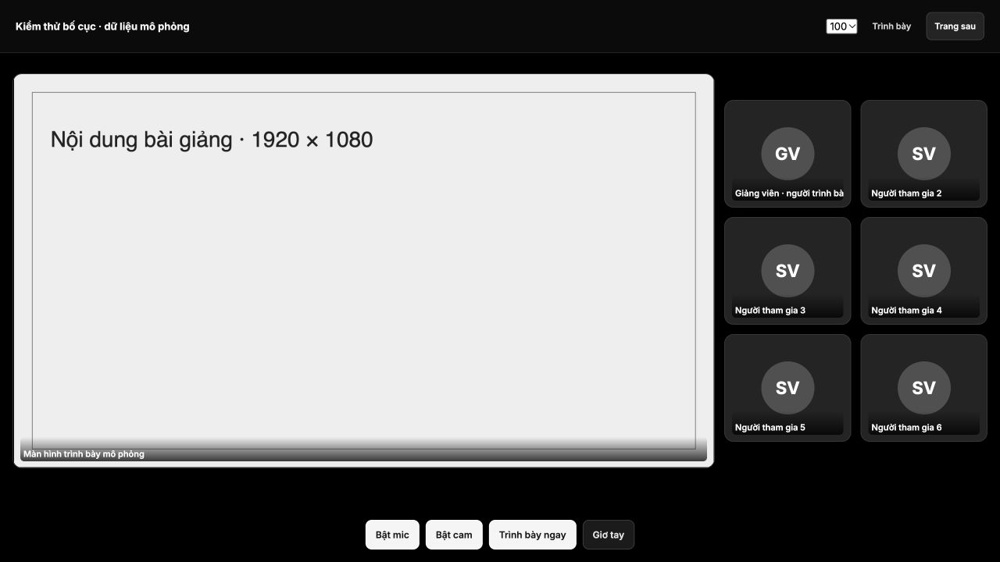

## Giới hạn của lượt review ban đầu

Không kiểm thử lại toàn bộ backend/E2E, luồng quản trị, truyền media thực, reconnect/realtime delta giữa hai người dùng, upload file, export Excel hoặc submit/chấm điểm. Các kết luận live ở trên chỉ áp dụng cho bố cục fixture. Chưa chạy build/test vì không thay đổi mã ứng dụng.

Lệnh `run-dev.sh` gặp lỗi 401 khi pull ảnh MinIO từ Quay. Infra local hiện có vẫn healthy; frontend và API đã được bật trực tiếp để thực hiện review. Đây là vấn đề khởi động môi trường, không được tính vào 10 lỗi UI.

## Kết quả sửa và kiểm chứng — 03/10/2026

Nhánh sửa: `module/fe-ui-audit-fixes`, dựa trên `ffb0064` (phụ thuộc PR #10 chưa merge). Phần đánh giá phía trên ghi nhận trạng thái trước khi sửa; bảng dưới ghi nhận kết quả sau sửa.

| Mã | Bản sửa | Kiểm chứng |
| --- | --- | --- |
| UI-01 | Mobile dùng drawer riêng, nội dung toàn chiều rộng; đóng bằng điều hướng, overlay/Escape và khôi phục focus/scroll. | Trình duyệt 375×812: chiều rộng trang/nội dung 375px; regression drawer/focus pass. |
| UI-02 | `MultipleChoice` dùng checkbox, lưu các key theo thứ tự canonical; observer hiển thị mọi đáp án đã chọn và không ghi dữ liệu. Radio giữ nguyên cho câu một đáp án. | 17 regression workspace pass: numeric/string type, thêm/bỏ lựa chọn, snapshot/in-place delta, guard saving/submitted, follow/inspect. |
| UI-03 | Nhãn enum theo domain; REST numeric và realtime string cùng nghĩa, trạng thái/độ khó được dịch tiếng Việt. | 9 regression nhãn/lỗi pass; đối chiếu thứ tự enum backend; sổ điểm thật hiển thị Bản nháp/Đã công bố. |
| UI-04 | API đọc bổ sung `StudentDisplayName` qua name-only batch contract của Identity sau kiểm tra quyền; roster, overview/detail, trợ giúp, sổ điểm và điểm danh dùng tên. | Trình duyệt thấy tên trong roster/observer/gradebook/attendance; integration chứng minh tenant isolation và sinh viên chỉ xem dữ liệu của mình. |
| UI-05 | Popup tài khoản ở ngoài vùng sidebar bị clip, giới hạn theo viewport và khôi phục focus. | Trình duyệt sidebar thu gọn: popup hiển thị đủ ở x=86–281; Escape trả focus. |
| UI-06 | Tự cuộn tab active khi đổi route, đổi title và resize. | 960×800 có nhiều tab: tab active nằm trong thanh tab (x=800–898, thanh x=288–898); regression reveal pass. |
| UI-07 | Điểm danh tách context/action và grid date/session/search; breakpoint xếp lại bộ lọc. | Desktop ba bộ lọc rộng 312/390/390px; mobile rộng 345px, xếp dọc, trang không tràn ngang. |
| UI-08 | Lưu `LateCutoffAt` tại lần vào đầu, giữ khi reconnect/đổi lịch; trễ dưới một phút hiển thị đúng; delayed earlier join sửa trạng thái tự động bằng cutoff gốc. | Unit cutoff và integration reconnect/reschedule/out-of-order/manual/legacy pass; 8 regression điểm danh/Excel pass. |
| UI-09 | Form dùng `errorMessage` chung, đọc validation/business reason, mapping tiếng Việt; giữ chi tiết lỗi chưa có mapping. | Trình duyệt gửi giờ kết thúc trước giờ bắt đầu: backend từ chối và UI giải thích bằng tiếng Việt. Regression kiểm tra 400/409, errors[]/field validation, ngưỡng tiểu luận, permission/network. |
| UI-10 | Nút đóng độc lập, có accessible name; tab aria-selected, Arrow/Home/End/Delete và focus sau đóng. | Trình duyệt Enter đóng tab inactive giữ route/focus sang control còn lại; đóng active chuyển route/focus tới tab lân cận; regression keyboard pass. |

### Build và kiểm thử

- `npm run typecheck`: PASS.
- `npm run build`: PASS. Rollup chỉ cảnh báo annotation `PURE` có sẵn trong package SignalR, không làm build thất bại.
- `node --test frontend/tests/*.test.mjs`: **53/53 PASS**.
- Backend solution build: PASS, 0 lỗi/0 cảnh báo.
- Unit `LiveSessionRulesTests`: **14/14 PASS**.
- Integration nhắm đúng các thay đổi Identity/Assessment/Attendance/LiveSession: **8/8 PASS**, gồm ba trường hợp join đến sai thứ tự.
- `dotnet format backend/LearningPlatform.sln --no-restore --verify-no-changes`: PASS.
- `git diff --check`: PASS.
- Hai lượt review source độc lập không phát hiện regression cụ thể trong frontend hoặc backend diff.

### Giới hạn và dữ liệu lịch sử

- Dữ liệu cũ đã ghi `Late` nhưng thiếu mốc tính trễ không được backfill bằng lịch hiện tại. Khi không xác định được thời lượng, UI ghi `Chưa xác định thời lượng`; điều chỉnh của giảng viên được giữ nguyên. Bản ghi mới lưu cutoff để báo cáo có cơ sở ổn định.
- Kiểm thử export chạy hàm tạo Blob thật, xác nhận tên được escape, số cột/ô và trạng thái người chưa vào lớp. Lượt tải file qua in-app browser không trả sự kiện download; chưa xác nhận file tải xuống hoặc mở bằng Excel desktop.
- Đây là xác minh các lỗi UI đã audit, không phải lượt full E2E mới. Chưa chạy truyền media thật hoặc realtime giữa hai tài khoản trong lượt này; observer Inspect/Follow Again đã kiểm tra trên trình duyệt và snapshot/delta qua component tests.

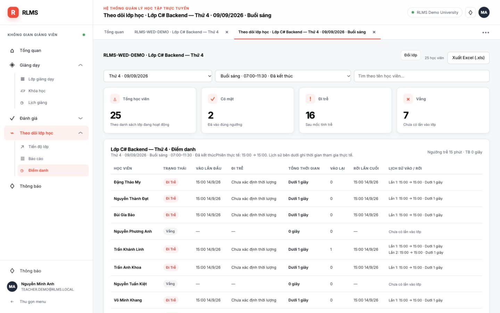

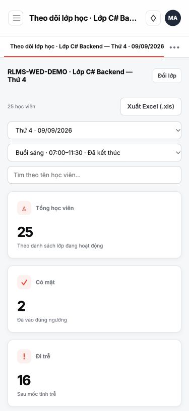

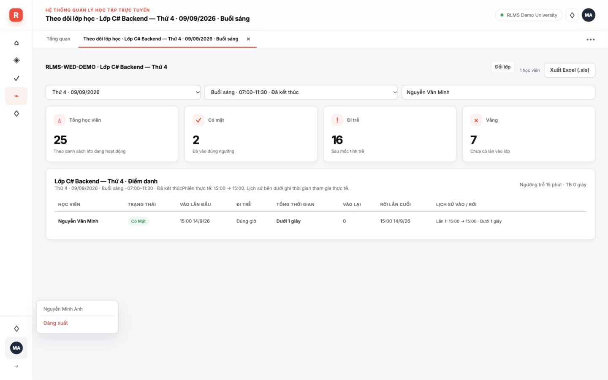

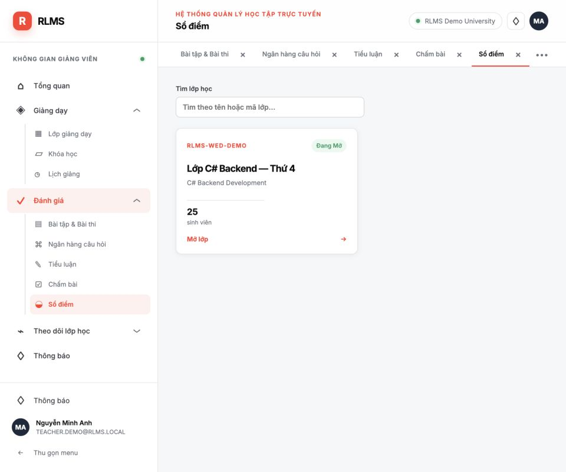

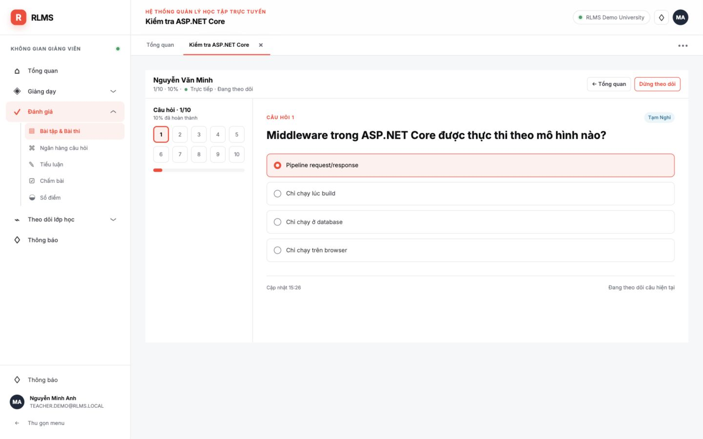

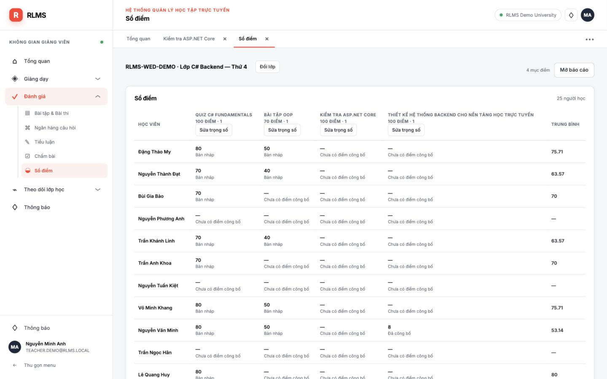

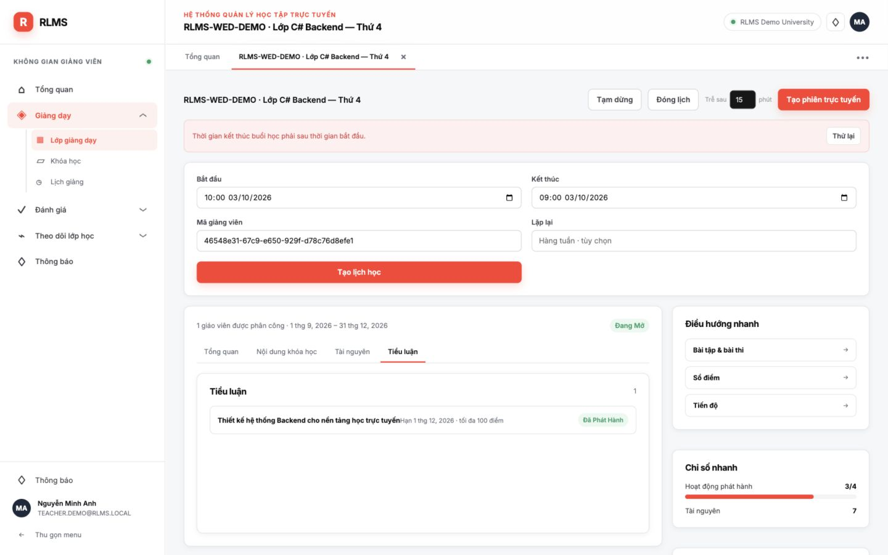
